<div align="center">


# Tabibu

![coverage][coverage_badge]
[![style: very good analysis][very_good_analysis_badge]][very_good_analysis_link]
[![License: MIT][license_badge]][license_link]

</div>

<div align="center">

<sub><i>"It is difficult to get the news from poems yet men die miserably every day for lack of what is found there."</i><br>
William Carlos Williams, physician and poet, in
<a href="https://poets.org/anthology/flowers-0">Asphodel, That Greeny Flower</a> (excerpt)</sub>

</div>

A biopsy is a few cells on a glass slide, and the news is in them. Someone has to be able to read it.
In Kenya that someone is scarce: [Brand and colleagues](https://pmc.ncbi.nlm.nih.gov/articles/PMC6180785)
(*Journal of Global Oncology*) report earlier studies putting the country at one pathologist for more
than 725,000 people, and, among the public hospitals they surveyed that could do histology, a median
wait of about 14 days for a result, with none inside the five days they call suggested. The reading
is only one stretch of that wait. The others are the order, the hand-off to a pathologist, the
report and its explanation, and those are the ones software can shorten.

Tabibu is my answer. It connects patients, doctors and
pathologists in Nairobi, in English and Kiswahili, and one record carries a person from booking to
result. AI prepares the pathologist's first read, the plain-language explanation and an outbreak
alert draft. A qualified person always decides: the pathologist signs, the doctor approves what the
patient reads, and an approver releases an alert.

**What I claim, and what I do not.** I claim the path: one order that becomes one case, a pathologist
who gets a pre-read to check instead of a blank page, and a patient who reads a signed result only
once their doctor has talked it through. I do not claim the AI reads slides well. On 200 held-out
tiles the pre-read was right 72% of the time at best, and it still missed about half of the tumour
tiles, so it is shown as a prompt, its confidence is capped at Low, and nothing reaches a person
without a human decision. The numbers, with their intervals, are in
[CRQ-0051](./docs/crq/reports/CRQ-0051-live-ai-on-the-meta-model-api.md).

### The story in five beats

The three-minute demo walks the same path, one role at a time. Sign in with the accounts under
[Trying it](#trying-it) and follow along.

| Beat | Who | What to watch for |
|---|---|---|
| 1. A question | Patient | Books a doctor near them and types what is wrong; the doctor receives it in two languages |
| 2. An order | Doctor | Accepts, orders a test, and asks a pathologist; the AI risk check advises and never clears |
| 3. The read | Pathologist | A desk of cases, a pre-read labelled as AI, scored by the pathologist before they write a word, then signed |
| 4. The news | Doctor, then patient | The doctor discusses the result and approves the explanation; only then does the patient see it, in Kiswahili if they choose |
| 5. The county | Approver | A confirmed finding becomes an anonymous count; an alert draft waits for a person to release it |


**Why beat 5 matters most.** The same scarcity shapes outbreaks. When confirming a disease depends on a
few people who can read a slide or run a test, a county learns of a cluster late. The World Health
Organization keeps COVID-19, Ebola virus disease and Marburg virus disease among its current
[priority diseases for research and development](https://www.who.int/activities/prioritizing-diseases-for-research-and-development-in-emergency-contexts),
and its [fact sheet](https://www.who.int/news-room/fact-sheets/detail/ebola-disease) puts the average
Ebola case fatality rate at around 50%, varying from 25% to 90% in past outbreaks. In May 2026 Kenya's
Ministry of Health issued a
[public advisory on the Ebola outbreak in Ituri Province](https://health.go.ke/sites/default/files/2026-05/PRESS%20RELEASE_EVD_DRC_Final.pdf)
in the Democratic Republic of the Congo. The alert engine is built for that gap. When a pathologist
signs a confirmed notifiable finding it becomes an anonymous count, with no patient and no clinic in
it. When a county's count calls for it, a draft alert in English and Kiswahili, grounded in Ministry
of Health and WHO guidance, waits for an approver, and only then reaches clinicians and then the
patients of that county. I do not claim this saves lives. I claim it removes one delay between a
confirmed result and a warning, and keeps a person in charge of the warning. The design is in the
[outbreak alert engine](docs/architecture/reports/outbreak_alert_engine.md).

Each role, in a line:

- **Patients** book doctors near them and read their results once their doctor has discussed
  them.
- **Doctors** see their day, order tests, and join multidisciplinary (MDT) consults.
- **Pathologists** work a desk of cases the AI read first, and sign every report themselves.

The app is Flutter on iOS, Android and the web, backed only by Firebase. No model is called from
the app: the AI service sits behind Cloud Functions.

## Hackathon and partners

Tabibu is built for the
[Meta Global AI Developer Hackathon](https://cerebralvalley.ai/e/meta-ai-developer-hackathon),
hosted by [Meta](https://www.meta.com/) and [Cerebral Valley](https://cerebralvalley.ai/), in the
Indie developer track, "Build for Your World" theme. The hackathon's inference partners are
[Baseten](https://www.baseten.co/), [Modal](https://modal.com/) and
[Fireworks](https://fireworks.ai/).

| | Role | What Tabibu uses |
|---|---|---|
| Meta | Host | One Muse model, `muse-spark-1.3`, through the Meta Model API: the order risk check, the symptom summary, tile labelling for the pathology pre-read, the plain-language explanation of a signed report, and the outbreak alert draft. The hackathon's API credits, and Muse Code, the coding agent Tabibu is built with. **Not used:** SAM 3.1, Muse Spark Open and Muse Voice Transcribe |
| Cerebral Valley | Host | The hackathon itself: the event, its schedule and its submission |
| Baseten | Inference partner | Not used by Tabibu. The Meta Model API serves the one model, so there is nothing to serve elsewhere |
| Modal | Inference partner | Not used by Tabibu, for the same reason |
| Fireworks | Inference partner | Not used by Tabibu |

> [!NOTE]
> The models run in Cloud Functions, never in the app, each behind its own Remote Config switch.
> Live: the risk check, the symptom summary, the pathology pre-read, the explanation drafts and the
> alert draft (which falls back to a fixed template whenever a check fails). Built but off: the
> report translation, and speech to text for symptoms and voice notes. Every AI output is a draft:
> a pathologist signs the report, the doctor approves the patient's explanation, and an approver
> releases an alert. What was measured, and what was not, is in
> [CRQ-0051](./docs/crq/reports/CRQ-0051-live-ai-on-the-meta-model-api.md).

## How it works

Each step is a Firestore write that a Cloud Function checks, and each step notifies the next
person. The order **is** the case, so one record carries a patient from booking to result.

| Step | What happens | AI |
|---|---|---|
| 1. Book | A patient books a doctor and types their symptoms (speech to text is built and off). | A symptom summary in English and Kiswahili for the doctor |
| 2. Accept | The doctor accepts, and the slot shows as busy on their public profile. | None |
| 3. Order | The doctor orders tests. The order gets an `ODR-…` number, and the payment method (cash, or an insurer and policy number) is recorded. Tabibu takes no money. | A risk check suggests tests and, from a fixed template, a protocol advisory. The doctor's notes are translated for the pathologist |
| 4. Assign | The doctor requests a pathologist, who has 24 hours to accept. | None |
| 5. Pre-read | For an image-bearing test, slides go up; the pathologist's desk ranks every case. | The pre-read: a label per tile, a heatmap and measurements built in code, and a draft report, readable **only by the case's pathologist** (S-1) |
| 6. Score and sign | The pathologist scores the pre-read, then edits and signs the report. The doctor opens it with a code from their inbox, behind the device's biometrics. | The pathologist approves the report's translation in one tap |
| 7. Release | The patient books a discussion. Only when the doctor marks it discussed does the patient see the result (S-3). | A plain-language explanation, which the doctor approves in one tap before the patient sees it |
| 8. Talk | Direct threads and MDT discussions carry text, images and voice notes. | None live (voice-note transcription is built and off) |
| 9. Alert | A pathologist's confirmed notifiable finding becomes an anonymous count. When a county's count calls for it, an alert is drafted. | An English and Kiswahili draft, grounded in bundled Ministry of Health and WHO guidance. It reaches clinicians, then patients in that county, **only after an authorised clinician approves it** |

```mermaid
sequenceDiagram
    actor P as Patient
    actor D as Doctor
    actor X as Pathologist
    participant F as Firebase (rules and functions)
    participant AI as AI service

    P->>F: Book, with symptoms typed
    F->>AI: Summarise (English, Kiswahili)
    AI-->>F: Summary for the doctor
    D->>F: Accept, then order tests
    F->>AI: Risk check on the new order
    AI-->>F: Advice, never a diagnosis
    D->>F: Request a pathologist
    X->>F: Accept within 24 hours
    F->>AI: Pre-read of the slides
    AI-->>X: Draft, readable only by this pathologist
    X->>F: Score the pre-read, edit, sign
    F-->>D: Signed report
    D->>F: Mark as discussed
    F->>AI: Draft a plain-language explanation
    AI-->>D: Draft in each language
    D->>F: Approve the explanation
    F-->>P: Result and approved explanation
```



> [!IMPORTANT]
> AI output reaches a person through a one-tap approval, or, where the threat model's S-8 names the
> reader as the qualified person who acts on it, directly. Either way it is labelled as AI.

The details are in the [architecture](docs/architecture/reports/mobile_architecture.md), the
[AI service](docs/architecture/reports/ai_preread_service.md), the
[notifications engine](docs/architecture/reports/notifications_engine.md), the
[outbreak alert engine](docs/architecture/reports/outbreak_alert_engine.md) and the
[threat model](docs/security/reports/firebase_and_ai_service_threat_model.md). The
architecture's §16 says what is live and what is not.

## Running it

You need the Flutter version in `pubspec.yaml`, and Java 21 and Node.js for the Firebase
emulators.

| Step | What happens |
|---|---|
| 1. `flutter pub get` | Fetches the packages |
| 2. `make gen` | Generates the models, routes, injectables and assets |
| 3. `make run-dev` | Runs the development flavor (also: `make run-web`) |

You are done when the app launches on a simulator, device or Chrome without a build error.

**If it goes sideways:**

- A missing `*.g.dart`, `*.freezed.dart` or `gen/` import means step 2 has not run; run `make gen`.
- A missing `AppLocalizations` string means the localizations are stale; run `make l10n`.
- `make run-dev` passes the App Check debug token from the macOS Keychain. Without one the app
  still builds and runs, because App Check is active but not enforced.

There are three flavors, `development`, `staging` and `production`, each with its own entry point
in `lib/main_<flavor>.dart`.

## Trying it

The live project has one demo account per role, all with demo data only. Sign in with email and
password:

| Role | Email | Who |
|---|---|---|
| Patient | `tabibu.demo+patient@gmail.com` | Amina Otieno, Nairobi |
| Doctor | `tabibu.demo+doctor@gmail.com` | Dr. Achieng Odhiambo, Mbagathi District Hospital; also the alert approver |
| Pathologist | `tabibu.demo+pathologist@gmail.com` | Dr. Wanjiru Kamau, Kenyatta National Hospital |

> [!WARNING]
> The password is shared with the judges alongside the submission, never in this repository. No
> credential belongs in code, assets, fixtures or docs.

The accounts come from `make seed-live`, which also adds two clinic patients and an admin account for
the Firebase console.

So that a patient's search and a doctor's pathologist picker have people to show, `make
seed-directory` adds 16 doctors and 6 pathologists from
[`functions/data/demo_directory.json`](functions/data/demo_directory.json): fictional people at
real Nairobi facilities, each with a `DEMO-` licence number. Their photos are stock models from
[Pexels](https://www.pexels.com/license/), free to use, with each photographer recorded in the
file; they are not pictures of the named people.

`make seed-cases` then gives the three accounts fourteen backdated cases at different stages, with
two alerts. Ids are keyed by `SEED_CASES_TAG` (empty by default). The slides are real public data
(PatchCamelyon tiles, CC0, and cells from the U.S. National Library of Medicine's thin-smear set,
fetched at seed time). The pre-reads are stored examples, each marked as one in the app, not live
model output.

| Key | Stage | What the demo uses it for |
|---|---|---|
| `requestWithSlide` | `PathologistRequested` | Pathologist: "New case waiting" (en: that title; sw: *Kesi mpya inasubiri*), one slide already registered — accept |
| `sampleDue` | `PrereadReady` | Pathologist: Ready stored pre-read, **no** accession — record the sample, then score and sign |
| `accepted` | `PathologistAccepted` | Pathologist: accepted, no slides yet (cytopathology) |
| `hero` | `PrereadReady` | Pathologist: Ready pre-read with accession already set |
| `queued` | `PrereadQueued` | Pathologist: slides in, pre-read still Queued |
| `lowConfidence` | `PrereadReady` | Pathologist: Ready pre-read, Low confidence band |
| `rejected` | `PathologistRejected` | Doctor: decline reason in the log — re-attach another pathologist |
| `requested` | `PathologistRequested` | Pathologist: request without slides |
| `signed` / `malaria` | `ReportSigned` | Doctor: unlock code / notifiable finding |
| `explained` / `completed` | released / done | Patient and doctor after discuss |
| `blood` / `cancelled` | in progress / cancelled | Edge stages |

After seeding, run the read-only check (no writes):

```sh
make check-demo CONFIRM=tabibu-86ea2
# or, with the same tag you seeded:
make check-demo CONFIRM=tabibu-86ea2 SEED_CASES_TAG=…
```

## Checking it

```sh
make fmt analyze bloc-lint   # formatting, analysis and bloc lints
make test                    # unit, bloc and widget tests
make rules-test              # Firestore and Storage rules on the emulator
make functions-test          # Cloud Functions on the emulator
make spell                   # spelling, English and Kiswahili terms
make secrets                 # secret scan
```

> [!TIP]
> To spell-check only the files you edited, run
> `npx cspell --no-progress -c .github/cspell.json <files>`; `make spell` covers the whole tree.

You are done when every command exits clean. A failure in one is yours to fix before a change
goes up, including spelling.

**If it goes sideways:**

- `make rules-test` and `make functions-test` need Java 21, and `make rules-test` stops if
  port 8080 or 9199 is already taken; stop the other emulator first.
- `make secrets` needs `gitleaks` (`brew install gitleaks`).

Every user-visible string lives in both `lib/l10n/arb/app_en.arb` and `app_sw.arb`; `make l10n`
regenerates the localizations.

## How it is built

| Read | For |
|---|---|
| [`AGENTS.md`](AGENTS.md) | The rules every change is held to |
| [Architecture](docs/architecture/reports/mobile_architecture.md) | Layering, data, routing, security, roles |
| [Design system](docs/design/reports/mobile_design_system.md) | Tokens, components, copy, accessibility |
| [Workflow](docs/workflow/reports/mobile_workflow.md) | How a change ships, and the definition of done |
| [Threat model](docs/security/reports/firebase_and_ai_service_threat_model.md) | The clinical-safety rules and security threats |
| [Change records](docs/crq/reports/README.md) | Why each change was made |

To contribute, see [`CONTRIBUTING.md`](CONTRIBUTING.md); to report a vulnerability, see
[`SECURITY.md`](SECURITY.md).

[coverage_badge]: coverage_badge.svg
[license_badge]: https://img.shields.io/badge/license-MIT-blue.svg
[license_link]: https://opensource.org/licenses/MIT
[very_good_analysis_badge]: https://img.shields.io/badge/style-very_good_analysis-B22C89.svg
[very_good_analysis_link]: https://pub.dev/packages/very_good_analysis
