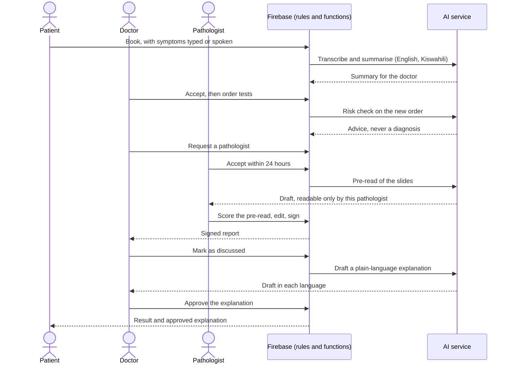

# Tabibu

![coverage][coverage_badge]
[![style: very good analysis][very_good_analysis_badge]][very_good_analysis_link]
[![License: MIT][license_badge]][license_link]

Tabibu connects patients, doctors and pathologists in Nairobi, in English and Kiswahili. AI
prepares a pathology pre-read and an outbreak alert draft; a qualified person always decides.

- **Patients** book doctors near them and read their results once their doctor has discussed
  them.
- **Doctors** see their day, order tests, and join multidisciplinary (MDT) consults.
- **Pathologists** work a desk of cases the AI read first, and sign every report themselves.

The app is Flutter on iOS, Android and the web, backed only by Firebase. No model is called from
the app: the AI service sits behind Cloud Functions.

## Hackathon and partners

Tabibu is built for the
[Meta Global AI Developer Hackathon](https://cerebralvalley.ai/e/meta-ai-developer-hackathon),
hosted by [Meta](https://www.meta.com/) and [Cerebral Valley](https://cerebralvalley.ai/), in the
Indie developer track, "Build for Your World" theme. The hackathon's inference partners are
[Baseten](https://www.baseten.co/), [Modal](https://modal.com/) and
[Fireworks](https://fireworks.ai/).

| | Role | What Tabibu uses |
|---|---|---|
| Meta | Host | The Muse models (Muse Spark, SAM 3.1, Muse Spark Open, Muse Voice Transcribe) through the Meta Model API, the API credits for the hackathon, and Muse Code, the coding agent Tabibu is built with |
| Cerebral Valley | Host | The hackathon itself: the event, its schedule and its submission |
| Baseten | Inference partner | Serving Muse Spark Open, which drafts the pathology report, the alert drafts and the patient explanations, on partner credits |
| Modal | Inference partner | Compute for the AI service, on partner credits |
| Fireworks | Inference partner | Not used by Tabibu |

> [!NOTE]
> The AI service that calls these models is the next branch; the architecture's §16 says what is
> built today.

## How it works

Each step is a Firestore write that a Cloud Function checks, and each step notifies the next
person. The order **is** the case, so one record carries a patient from booking to result.

| Step | What happens | AI |
|---|---|---|
| 1. Book | A patient books a doctor and types or speaks their symptoms. | Speech to text, which the patient checks before sending; the audio is then deleted. A symptom summary in English and Kiswahili for the doctor |
| 2. Accept | The doctor accepts, and the slot shows as busy on their public profile. | None |
| 3. Order | The doctor orders tests. The order gets an `ODR-…` number, and the payment method (cash, or an insurer and policy number) is recorded. Tabibu takes no money. | A risk check suggests tests and, from a fixed template, a protocol advisory. The doctor's notes are translated for the pathologist |
| 4. Assign | The doctor requests a pathologist, who has 24 hours to accept. | None |
| 5. Pre-read | For an image-bearing test, slides go up; the pathologist's desk ranks every case. | The pre-read: masks, labels, measurements in code and a draft report, readable **only by the case's pathologist** (S-1) |
| 6. Score and sign | The pathologist scores the pre-read, then edits and signs the report. The doctor opens it with a code from their inbox, behind the device's biometrics. | The pathologist approves the report's translation in one tap |
| 7. Release | The patient books a discussion. Only when the doctor marks it discussed does the patient see the result (S-3). | A plain-language explanation, which the doctor approves in one tap before the patient sees it |
| 8. Talk | Direct threads and MDT discussions carry text, images and voice notes. | Voice notes are transcribed for clinicians; a patient reads a clinician's transcript only once the sender shares it |
| 9. Alert | A pathologist's confirmed notifiable finding becomes an anonymous count. When a county's count calls for it, an alert is drafted. | An English and Kiswahili draft, grounded in bundled Ministry of Health and WHO guidance. It reaches clinicians, then patients in that county, **only after an authorised clinician approves it** |



> [!IMPORTANT]
> AI output reaches a person through a one-tap approval, or, where the threat model's S-8 names the
> reader as the qualified person who acts on it, directly. Either way it is labelled as AI.

The details are in the [architecture](docs/architecture/reports/mobile_architecture.md), the
[AI service](docs/architecture/reports/ai_preread_service.md), the
[notifications engine](docs/architecture/reports/notifications_engine.md), the
[outbreak alert engine](docs/architecture/reports/outbreak_alert_engine.md) and the
[threat model](docs/security/reports/firebase_and_ai_service_threat_model.md). The data layer for
these steps is being built on `feat/infra`; the architecture's §16 says what exists today.

## Running it

You need the Flutter version in `pubspec.yaml`, and Java 21 and Node.js for the Firebase
emulators.

| Step | What happens |
|---|---|
| 1. `flutter pub get` | Fetches the packages |
| 2. `make gen` | Generates the models, routes, injectables and assets |
| 3. `make run-dev` | Runs the development flavor (also: `make run-web`) |

You are done when the app launches on a simulator, device or Chrome without a build error.

**If it goes sideways:**

- A missing `*.g.dart`, `*.freezed.dart` or `gen/` import means step 2 has not run; run `make gen`.
- A missing `AppLocalizations` string means the localizations are stale; run `make l10n`.
- `make run-dev` passes the App Check debug token from the macOS Keychain. Without one the app
  still builds and runs, because App Check is active but not enforced.

There are three flavors, `development`, `staging` and `production`, each with its own entry point
in `lib/main_<flavor>.dart`.

## Trying it

The live project has one demo account per role, all with demo data only. Sign in with email and
password:

| Role | Email | Who |
|---|---|---|
| Patient | `tabibu.demo+patient@gmail.com` | Amina Otieno, Nairobi |
| Doctor | `tabibu.demo+doctor@gmail.com` | Dr. Achieng Odhiambo, Mbagathi District Hospital; also the alert approver |
| Pathologist | `tabibu.demo+pathologist@gmail.com` | Dr. Wanjiru Kamau, Kenyatta National Hospital |

> [!WARNING]
> The password is shared with the judges alongside the submission, never in this repository. No
> credential belongs in code, assets, fixtures or docs.

The accounts come from `make seed-live`, which also adds two clinic patients and an admin account for
the Firebase console.

So that a patient's search and a doctor's pathologist picker have people to show, `make
seed-directory` adds 16 doctors and 6 pathologists from
[`functions/data/demo_directory.json`](functions/data/demo_directory.json): fictional people at
real Nairobi facilities, each with a `DEMO-` licence number. Their photos are stock models from
[Pexels](https://www.pexels.com/license/), free to use, with each photographer recorded in the
file; they are not pictures of the named people.

## Checking it

```sh
make fmt analyze bloc-lint   # formatting, analysis and bloc lints
make test                    # unit, bloc and widget tests
make rules-test              # Firestore and Storage rules on the emulator
make functions-test          # Cloud Functions on the emulator
make spell                   # spelling, English and Kiswahili terms
make secrets                 # secret scan
```

> [!TIP]
> To spell-check only the files you edited, run
> `npx cspell --no-progress -c .github/cspell.json <files>`; `make spell` covers the whole tree.

You are done when every command exits clean. A failure in one is yours to fix before a change
goes up, including spelling.

**If it goes sideways:**

- `make rules-test` and `make functions-test` need Java 21, and `make rules-test` stops if
  port 8080 or 9199 is already taken; stop the other emulator first.
- `make secrets` needs `gitleaks` (`brew install gitleaks`).

Every user-visible string lives in both `lib/l10n/arb/app_en.arb` and `app_sw.arb`; `make l10n`
regenerates the localizations.

## How it is built

| Read | For |
|---|---|
| [`AGENTS.md`](AGENTS.md) | The rules every change is held to |
| [Architecture](docs/architecture/reports/mobile_architecture.md) | Layering, data, routing, security, roles |
| [Design system](docs/design/reports/mobile_design_system.md) | Tokens, components, copy, accessibility |
| [Workflow](docs/workflow/reports/mobile_workflow.md) | How a change ships, and the definition of done |
| [Threat model](docs/security/reports/firebase_and_ai_service_threat_model.md) | The clinical-safety rules and security threats |
| [Change records](docs/crq/reports/README.md) | Why each change was made |

To contribute, see [`CONTRIBUTING.md`](CONTRIBUTING.md); to report a vulnerability, see
[`SECURITY.md`](SECURITY.md).

[coverage_badge]: coverage_badge.svg
[license_badge]: https://img.shields.io/badge/license-MIT-blue.svg
[license_link]: https://opensource.org/licenses/MIT
[very_good_analysis_badge]: https://img.shields.io/badge/style-very_good_analysis-B22C89.svg
[very_good_analysis_link]: https://pub.dev/packages/very_good_analysis
